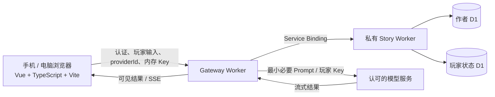

# 网页架构

本页为已确认方向的实现建议，具体接口、身份机制与发布命令在对应 Issue 中验证。



网页静态资源可通过 Cloudflare Workers Static Assets 托管。优先考虑网页与 API 同源，减少跨域配置复杂度；游戏 API 仍需验证身份，静态页面公开可访问不等于游戏数据公开。

Gateway 校验会话、请求大小、模型参数和 providerId，通过绑定调用私有 Story，再转发允许的模型请求。Story 负责可见性检索、作者导入授权、变量、事件与玩家存档。

作者库和玩家状态库分开绑定。玩家资源读写删除均用已验证身份约束所有者。并发写入使用版本和一致性方案。私有 Story 无公开 workers.dev、自定义域名、routes 或预览入口，仅由绑定调用；服务绑定不代替业务授权。

开发、预览与生产 D1 和密钥分别配置。部署任务提供检查、回退与发布说明，本次规划调整不执行实际部署。CPU、D1 用量、流式连接和延迟在内测及后续模拟负载中分开测量。

## 建议目录

```text
apps/web/            响应式网页
workers/gateway/     认证、模型白名单和 SSE
workers/story/       私有设定、变量、规则和存档
packages/contracts/ 请求响应与 Schema
packages/compat/    角色卡与世界书适配
packages/rules/     服务端领域引擎和虚构 fixtures
docs/               需求、决策与计划
```

Windows / Android 安装包若之后需要，可复用网页界面和云端服务；打包不作为第一阶段前置任务。

## 参考

- [Workers Static Assets](https://developers.cloudflare.com/workers/static-assets/)
- [Service bindings](https://developers.cloudflare.com/workers/runtime-apis/bindings/service-bindings/)
- [资源 bindings](https://developers.cloudflare.com/workers/runtime-apis/bindings/)
- [Workers limits：实现与压测时复核](https://developers.cloudflare.com/workers/platform/limits/)
