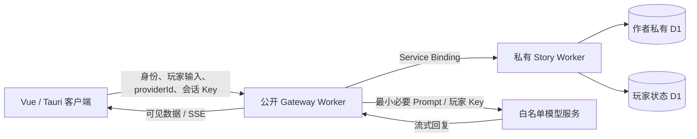

# 架构建议

本页是由既定需求推导的建议，具体接口和目录在相应 Issue 中落地。



Gateway 验证身份、请求大小与供应商，调用私有剧情服务，并规范化模型流。Story 负责授权后的检索、规则判定、变量与存档。可先保留少量清晰服务边界，不为每个功能创建单独 Worker。

作者数据与玩家状态使用分开的 D1 数据库。作者库只绑定私有服务；状态查询和写入必须包含可信 playerId 及资源所有权约束。并发更新使用版本与一致性方案，具体机制在实现时验证。

私有 Story 不暴露 workers.dev、自定义域名、routes 或预览入口，仅通过绑定调用。Service Binding 本身不代替业务授权；传入的身份必须已经验证，仍需在各操作检查权限。

建议同一 Cloudflare 账号内通过 Worker 与资源绑定划分职责。当前不实现多账号耗尽后自动切换。免费额度是否满足内测由模拟负载测量，不在文档中承诺。

CPU 用量和网络等待分开测量；Token 估计、世界书扫描与正则属于需要关注的计算工作，流式连接还有独立的生命周期限制。

## 建议目录

```text
apps/client/          Vue 与 Tauri 客户端
workers/gateway/      公开认证网关与模型适配
workers/story/        私有设定、规则和状态服务
packages/contracts/  请求响应与变量 Schema
packages/compat/     角色卡、世界书与预设适配
packages/rules/      服务端领域规则与虚构测试资料
docs/                项目交接与决策
```

## 参考

- [Cloudflare Service bindings](https://developers.cloudflare.com/workers/runtime-apis/bindings/service-bindings/)
- [Cloudflare resource bindings](https://developers.cloudflare.com/workers/runtime-apis/bindings/)
- [Workers limits：实现与压测时复核](https://developers.cloudflare.com/workers/platform/limits/)
